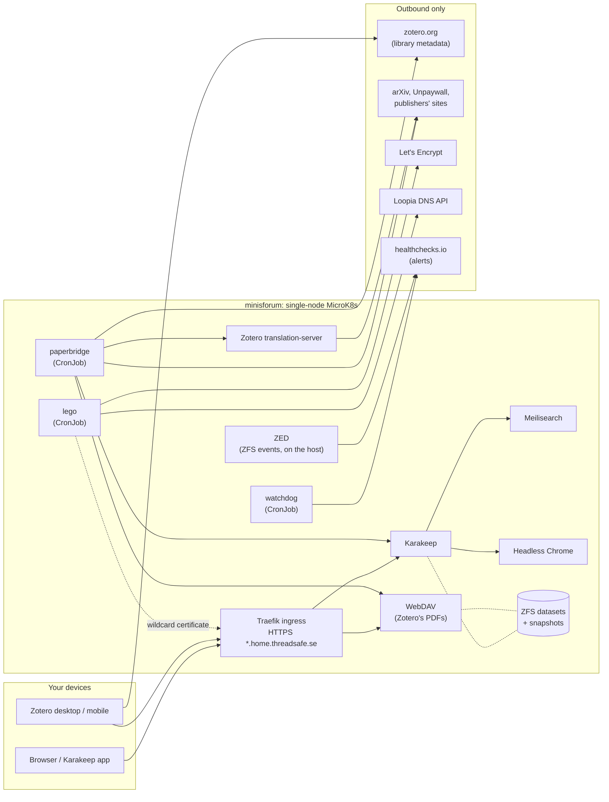

# HomeLab

This is the infrastructure-as-code for one person's home server: a small
machine in a closet called `minisforum`. It describes what runs on it, why
it is set up the way it is, and how to rebuild all of it from scratch.

It's public because there's no reason for it not to be. You're welcome to
read it or borrow from it. Nothing here is a product, though: it's tuned to
one home network, one server and one person's reading habits.

> **Status:** the research pipeline runs: Karakeep, Zotero's file
> storage, and paperbridge, which hands papers to Zotero and keeps both
> sides in sync, Zotero highlights included. A watchdog reports failures
> to healthchecks.io. Things marked *(planned)* below aren't running yet. The detailed, current state is in the "Status"
> section of [CLAUDE.md](CLAUDE.md).

## What it's for

The first stack is a **research and reading pipeline**. It solves three
annoyances:

1. **Saving and reading happen in different places.** Articles, blog posts
   and papers get saved from everywhere. [Karakeep](https://karakeep.app),
   a self-hosted bookmark manager, is the single inbox for all of it. It
   keeps an archived copy of each page, makes everything searchable, and is
   the *register*: the one place to ask "what have I saved, and have I
   read it?".
2. **Papers deserve a proper reference manager.**
   [Zotero](https://www.zotero.org) is where papers get read, highlighted
   and cited. Zotero's own file storage is small on the free plan, so PDFs
   are stored at home on a WebDAV server. Only the library metadata (titles,
   authors, notes, highlights) syncs through zotero.org.
3. **Moving papers between the two by hand is tedious.** *paperbridge* (a
   working name) is a small service written here:
   - A bookmark tagged `paper` in Karakeep becomes a complete Zotero item,
     with metadata looked up automatically and the PDF placed in Zotero's
     storage.
   - When a paper is marked read in Zotero, Karakeep archives the
     bookmark and tags it with the month it was read.
   - Titles, authors, dates, abstracts and comments stay in sync both
     ways.
   - Highlights made in Zotero are copied into the Karakeep bookmark's
     note, so searching Karakeep also finds highlighted passages.
   - Karakeep's lists decide how papers are filed in Zotero. The lists
     chosen for it, with their sublists, appear in Zotero as collections,
     and moving a bookmark in Karakeep moves the paper in Zotero. There's
     one structure to maintain, and it lives in Karakeep. Papers added in
     Zotero directly are left alone.

A side benefit: everything lives at home, as plain files on our own disks.
And because Karakeep keeps the full text, an AI assistant can read saved
papers through Karakeep's MCP server.

## How it fits together



Only Traefik is reachable from the LAN. Everything else is cluster-internal.
The only things that leave the house are outbound calls:
- zotero.org, for library sync;
- Let's Encrypt plus Loopia's API, for certificates;
- healthchecks.io, for alerts;
- the web itself, for the pages being saved and for papers' metadata and
  open-access PDFs.

### Day to day

1. Bookmark a paper in Karakeep: its arXiv or doi.org link, the
   publisher's page, or the PDF itself. Tag it `paper`.
2. Within 15 minutes paperbridge has made it a Zotero item, with full
   metadata and, when one can be found, the PDF. The bookmark gets the tag
   `in-zotero`, and its note links to the Zotero item.
3. Zotero desktop or mobile shows the paper after its next sync. If the
   bookmark is in a list under one of the mirrored lists, the paper is in
   the matching collection; move the bookmark, and the paper follows.
4. Comment wherever is handy: the bookmark's note in Karakeep, or the
   paper's "From Karakeep" note in Zotero. Each shows up on the other side.
   Corrections to the title, authors or abstract cross over the same way.
5. Highlight and annotate in Zotero. The highlights, with page numbers and
   your comments on them, appear in the bookmark's note in Karakeep.
6. Mark the paper Read in Zotero (with the Reading List plugin). Karakeep
   then archives the bookmark and tags it, e.g. `read-2026-10`.

A paper that's already in Zotero (same DOI) is linked, not duplicated. If
no translator recognises a page, paperbridge keeps trying for a day, then
creates a minimal item tagged `needs-metadata` to fix by hand.

### How to add a paper

Step 1 above, by where you find the paper. Everything goes into Karakeep,
tagged `paper`; paperbridge does the rest.

| You find… | Do this | In Zotero you get |
|---|---|---|
| A paper page in the browser (arXiv, a journal, a DOI link) | Save it with Karakeep's browser extension; add the tag `paper` in its popup | The item with metadata, plus the PDF if it's on arXiv or open access |
| Something on your phone | Share it to the Karakeep app and tag it `paper` (away from home: over the router's VPN) | Same as above |
| A PDF you already have (a paywalled download, an email attachment, from a colleague) | Upload the file in Karakeep (drag it into the web page, or use the app) and tag it `paper` | A new item, or the PDF filled into an item that's already there without one |
| Just a reference (a DOI or arXiv ID in a citation) | Paste `https://doi.org/<DOI>` into Karakeep's add box and tag it `paper` | The item with metadata, plus the PDF if one is freely available |
| A folder of PDFs you downloaded | Describe the folder in a collection file, `imports/<name>.json`, then run `scripts/import_pdfs.py imports/<name>.json`: a dry run first, then `--apply`. Rerun as you add files; nothing is added twice. [`imports/README.md`](imports/README.md) is the full specification, with a one-paper example | One item per paper, with metadata and your PDF, in the matching collection |
| Many links at once, from a script | Karakeep's API: `POST /api/v1/bookmarks` with `{"type": "link", "url": …}`, then `POST /api/v1/bookmarks/<id>/tags` with `{"tags": [{"tagName": "paper"}]}`. Use an API key of its own, not paperbridge's | As the rows above |

**Paywalled papers take two steps:**
1. **Save the page** as soon as you find it. Zotero gets the item with its
   metadata right away, but no PDF.
2. **Upload the PDF** to Karakeep once you've downloaded it. paperbridge
   recognises the paper by DOI or title and attaches the PDF to the
   existing item. Nothing gets duplicated.

The paper then has two bookmarks in Karakeep, the page and the PDF. Both
point to the same Zotero item, and marking it Read archives both.

- **Tagging can be automatic.** A Karakeep rule (Settings → Rules) can add
  `paper` when a URL contains `arxiv.org`, `doi.org` or a publisher you
  use often.
- **Zotero's own "Save to Zotero" button bypasses all of this.** Papers
  saved that way stay in Zotero only, and Karakeep never sees them. Use it
  only for things you want in Zotero alone.

## Design choices, and why

- **LAN-only, with the router's VPN for remote access.**
  - The router already runs a VPN, and a VPN client lands on the LAN like
    any other machine. So the server runs no VPN of its own, and nothing is
    port-forwarded.
  - The flip side is that "on the LAN" is not a security boundary. Every
    exposed service has its own login, and internal services are not
    exposed at all.
- **Real HTTPS without exposing anything.**
  - Services get names under `*.home.threadsafe.se`, a public DNS record
    that points at the server's private LAN address. The names work
    everywhere, but they lead nowhere unless you're on the LAN.
  - [lego](https://go-acme.github.io/lego/) gets a Let's Encrypt wildcard
    certificate through a **DNS-01** challenge. It proves ownership by
    creating a temporary TXT record through Loopia's API, so Let's Encrypt
    never has to connect to the server.
  - The wildcard keeps individual service names out of the public
    certificate logs.
  - The usual tool, cert-manager, was skipped: its only Loopia integration
    is unmaintained since 2021.
- **Single-node [MicroK8s](https://microk8s.io).** It's one machine, so
  there's no high availability to pretend at. Kubernetes still earns its
  place: every service is declared in files, isolated, restartable, and
  rebuilt with one command. MicroK8s is a single snap with the cluster DNS,
  networking and ingress (Traefik) as addons.
- **Data on ZFS, not on the system disk.**
  - Each service's data is its own dataset on a raidz1 pool of four disks
    (in a USB enclosure; a mini PC has no room inside), with automatic
    snapshots (hourly, daily, monthly) by
    [sanoid](https://github.com/jimsalterjrs/sanoid).
  - This machine has a history of hard power-offs. Once, an ext4 file was
    left empty by one of them, which quietly broke the original cluster
    for months. ZFS's copy-on-write design doesn't produce half-written
    files like that.
- **paperbridge keeps no state of its own.**
  - The `in-zotero` tag on a bookmark means "done", and a line in the
    Zotero item's Extra field points back at the bookmark. If a run stops
    halfway, the next one finds what was already done and finishes it.
  - Zotero's web API can't upload files to WebDAV storage. So paperbridge
    writes the PDF into the WebDAV folder itself, in the same zip-plus-
    checksum format Zotero desktop uses there, and only then creates the
    attachment in the library. Zotero desktop downloads it like any synced
    file.
- **One entry point for files and structure: Karakeep.**
  - Syncing files and folders in two directions invites conflicts. So
    PDFs and Karakeep's lists flow one way, Karakeep → Zotero, and
    Zotero's collections are never organized by hand.
  - Comments and metadata are different: those sync both ways, field by
    field. When both sides changed the same field, Zotero wins, since
    that's where bibliographic data gets curated. Comments edited on both
    sides keep both texts, so nothing is lost.
  - To tell which side changed, paperbridge keeps a small snapshot of
    the last-synced values on its own ZFS dataset.
  - Highlights are the exception: they go one way, Zotero → Karakeep. A
    Zotero highlight is anchored to a spot on a PDF page, and Karakeep's
    are anchored to its text of a web page. There's no reliable way to
    turn one into the other.
  - Karakeep holds more than papers. Only the lists named in
    `MIRROR_LISTS` (in `k8s/research/paperbridge/paperbridge.env`) are
    mirrored, with everything under them.
  - Papers added to Zotero directly, and collections outside those trees,
    are left alone. To bring such a paper into Karakeep, take its PDF out
    of Zotero and add it there. paperbridge recognises the paper and links
    it, instead of making a duplicate.
  - An emptied collection goes to Zotero's trash rather than being
    deleted, so nothing is lost by accident.
- **Alerts come from outside the house.** A small watchdog checks every 5
  minutes:
  - the disk pool;
  - the scheduled jobs (paperbridge, certificate renewal);
  - that every service is running and answering;
  - how long the certificate has left.

  ZFS's own event daemon reports disk trouble the moment it happens, which
  matters because all four disks hang off one USB enclosure. Each check
  reports pass or fail to [healthchecks.io](https://healthchecks.io), which
  sends the alert, by email or any push service it supports, and only when
  something changes. It also notices when the reports stop, which is the
  one failure a server can't report about itself: when it's off.
- **Exact versions, updated by pull request.** Every image, package and
  tool is pinned to an exact version (images also to a digest), so the
  server never changes underneath you. To keep them current,
  [Renovate](https://docs.renovatebot.com) opens pull requests once a week,
  grouped by what has to happen after merging: re-apply the cluster, cut a
  paperbridge release, or rerun a host script. Nothing merges by itself.
  Kubernetes upgrades, and Meilisearch, which has to match Karakeep, are
  only proposed when asked for, from Renovate's dashboard issue.
- **The repo is the rebuild recipe.** Host setup is idempotent scripts.
  Everything in the cluster is plain Kubernetes manifests, applied with a
  single `kubectl apply -k k8s/`. We add no Helm charts, operators or CRDs
  of our own. Secrets are the one thing outside git: their names are in
  `.env.example`, and their values in a local `.env`.

## What's in the repo

| Path | What it is |
|---|---|
| `README.md` | This file: purpose, design, how to rebuild |
| `CLAUDE.md` | The detailed spec and working notes. [Claude Code](https://claude.com/claude-code), the AI coding assistant this was built with, reads it at the start of every session. It has the exact versions, UIDs, gotchas and open questions. Worth reading for the "how exactly" |
| `host/` | Idempotent scripts run once on the server with sudo (storage, MicroK8s, ZFS alerts) |
| `k8s/` | Kubernetes manifests, one directory per area: `storage/` (ZFS-backed volumes), `ingress/` (certificates), `research/` (the apps), `monitoring/` (the watchdog) |
| `scripts/` | Helpers run from your machine: `secrets.sh` turns `.env` into Kubernetes Secrets; `import_pdfs.py` uploads a folder of PDFs to Karakeep |
| `imports/` | Paper collections for `import_pdfs.py`, one file per folder of papers, and their specification ([`imports/README.md`](imports/README.md)) |
| `images/` | Third-party images we build ourselves, e.g. Zotero's translation-server, because the published one is ARM-only |
| `services/paperbridge/` | The glue service: its Python source, tests and container build |
| `.github/workflows/` | GitHub Actions that build those images and publish them to `ghcr.io/mufflon/*` |
| `renovate.json` | What Renovate keeps up to date, how it groups the pull requests, and when |
| `.env.example` | Every secret the setup needs, by name only |

## Prerequisites (outside this repo)

1. **Server**
   - Ubuntu 26.04 LTS, your user with SSH key access and sudo.
   - A **fixed LAN address**: a DHCP reservation on the router. The DNS
     record below points at it.
2. **ZFS pool `hddpool`**
   - It also holds the media library, so this repo never creates or
     destroys it.
   - If it already exists, the cluster's data in `hddpool/k8s/*` is reused
     on rebuild: the PersistentVolumes are `Retain` and point at the same
     paths.
3. **DNS at Loopia, for `threadsafe.se`**
   - An A record `*.home.threadsafe.se` → the server's LAN address. It is
     public, but it points at a private IP.
   - A LoopiaAPI user for certificate renewal, with exactly these rights:
     `getZoneRecords`, `addZoneRecord`, `removeZoneRecord`,
     `removeSubdomain`. Nothing else: no domain, billing or DNS-server
     rights.
4. **Router**
   - The VPN server for remote access.
   - **No** port forwards to this server.
   - DNS rebind protection, if any, must allow `home.threadsafe.se`.
5. **Accounts**
   - A Zotero account, and an API key with library read/write.
   - Optionally, an email address for Unpaywall's open-access lookup. It
     needs no account; it just asks callers to identify themselves.
   - The Karakeep API key is created during the build (step 4).
   - A [healthchecks.io](https://healthchecks.io) account for alerts (the
     free plan is enough). From its project's Settings → API Access, the
     **read-write** API key goes in `.env`. The watchdog creates the checks
     itself. Pick how alerts reach you under Integrations; email to the
     account's address is there from the start.
   - For update pull requests, the
     [Renovate GitHub App](https://github.com/apps/renovate), installed on
     this repository only. It isn't needed to rebuild.
6. **Your machine** (the workstation you manage the cluster from, not the
   server)
   - A clone of this repo, with `.env` filled in from `.env.example`.
     `.env` stays on this machine: it is gitignored, and the server never
     stores it. `scripts/secrets.sh` sends the values into the cluster as
     Secrets.
   - `kubectl` within one minor version of the cluster.

## Rebuild

Run the host scripts on the server. Each one is idempotent, so a rerun
only fixes what is missing. Typing the sudo password is the only
interactive part.

```bash
scp host/*.sh minisforum:
ssh -t minisforum 'sudo bash ./00-prep.sh 2>&1 | tee 00-prep.log'
ssh -t minisforum 'sudo bash ./01-microk8s.sh 2>&1 | tee 01-microk8s.log'
```

1. **`host/00-prep.sh`** sets up storage:
   - the ZFS datasets under `hddpool/k8s`, each owned by the UID its app
     runs as;
   - sanoid snapshots for `zotero-webdav`, `karakeep`, `certs` and
     `paperbridge`.
2. **`host/01-microk8s.sh`** sets up the cluster:
   - MicroK8s `1.36/stable` (rerun after the channel in the script was
     bumped, it upgrades the cluster to it);
   - the Traefik ingress addon, using the wildcard certificate as the
     default;
   - then the Traefik chart version pinned in the script, with its full
     configuration written out there: the dashboard switched off, and HTTP
     redirected to HTTPS.
3. **Kubeconfig:** `ssh minisforum microk8s config > ~/.kube/homelab`.
   Point `KUBECONFIG` at it. Never commit it.
4. **Secrets:** `scripts/secrets.sh` creates every Kubernetes Secret from
   `.env`. Secrets whose values aren't filled in yet are skipped.
5. **Everything else:** `kubectl apply -k k8s/`.
   - Storage (StorageClass + PVs) and the lego certificate CronJob.
   - The research apps: WebDAV, translation-server, Karakeep with
     Meilisearch and headless Chrome, and the paperbridge CronJob.
   - No Helm charts and no CRDs of our own, so a single apply is enough.
6. **First certificate:** run the CronJob once instead of waiting for its
   schedule:

   ```bash
   kubectl -n ingress create job lego-now --from=cronjob/lego
   ```

   It usually takes 1–5 minutes, mostly waiting for Loopia's DNS. After
   that the CronJob renews by itself.
7. **First-run steps per app:**
   - **Karakeep.** If its data on `hddpool/k8s/karakeep` survived, your
     account is still there and there's nothing to do. On a **completely
     empty** rebuild:
     1. Set `DISABLE_SIGNUPS=false` in `k8s/research/karakeep/karakeep.env`
        and apply.
     2. Create your account. The first one becomes admin.
     3. Set it back to `true` and apply again.

     Then, in Karakeep → Settings → API Keys, create the key for
     paperbridge, put it in `.env` and rerun `scripts/secrets.sh`.
   - **Zotero desktop:** Settings → Account → File Syncing → WebDAV, URL
     `https://zotero-dav.home.threadsafe.se/`, user and password from
     `.env`, then "Verify Server". For read status, also install the
     [Reading List](https://github.com/Dominic-DallOsto/zotero-reading-list)
     plugin.
   - **paperbridge** needs the Karakeep key from above plus the Zotero
     user ID and API key in `.env`, then `scripts/secrets.sh`. Until its
     Secret exists, each run of its CronJob fails at start, which is
     harmless.
   - **Optional, auto-tagging papers:** in Karakeep → Settings → Rules,
     add a rule "when a bookmark is added, if the URL contains `arxiv.org`
     or `doi.org`, add the tag `paper`". Rules live in Karakeep's database,
     so they survive a rebuild with the data and aren't in this repo.

8. **Alerts:** once the watchdog has run (it runs every 5 minutes, and
   creates its checks in healthchecks.io), hook ZFS's event daemon up to
   them:

   ```bash
   ssh -t minisforum 'sudo bash ./02-alerts.sh 2>&1 | tee 02-alerts.log'
   ```

   `sudo bash ./02-alerts.sh test` then proves it: it faults a disk in a
   throwaway file-backed pool, and an alert should arrive within a minute.

## What this does not cover

- **Highlights made in Karakeep don't reach Zotero.** Zotero's highlights
  are copied into Karakeep, but not the other way: a Karakeep highlight
  marks a spot in its text of a page, while Zotero needs a spot on a PDF
  page. Comments do sync both ways. This may be solvable later; see
  CLAUDE.md.

- **Clean shutdown on power loss.** There is a UPS, but it isn't connected
  to the server, so a long outage still ends in a hard power-off. A USB
  link plus NUT would fix that.
- **Disk health beyond ZFS.** Alerts come from ZFS itself and from the
  pool's state. There are no SMART checks (whether the USB enclosure
  passes SMART through is unverified), and a USB reset that ZFS shrugs off
  goes unnoticed.
- **Off-site backup.** sanoid snapshots live on the same pool, so they
  protect against mistakes, not against losing the pool. Off-site copies
  (e.g. `syncoid` to another machine) are not set up.
- **The media library, Jellyfin and NFS.** They run on the host, outside
  Kubernetes, and are not managed here.
